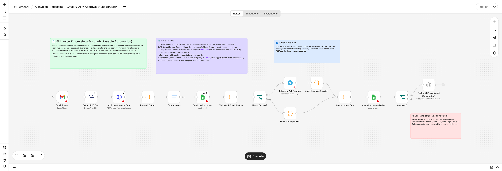

# AI Invoice Processing for n8n (Accounts Payable Automation)

Supplier invoices arrive by e-mail. AI reads the PDF, checks it against your history, auto-approves the clean ones, asks a human on Telegram about the risky ones, and logs everything to a Google Sheet ledger. Approved invoices can be pushed to your ERP.



```
Gmail (PDF) → Extract text → OpenAI (structured JSON) → Only invoices
   → Read ledger → Validate & check history ─┬─ warnings → Telegram Approve / Reject ─┐
                                             └─ clean    → Auto-approve ─────────────┤
   → Append to ledger (Google Sheets) → Approved? → Post to ERP (optional)  ◄────────┘
```

## What it catches

| Check | Example warning |
|---|---|
| Duplicate invoice (same vendor + invoice number) | `POSSIBLE DUPLICATE: this vendor + invoice number is already recorded` |
| Arithmetic errors | `Subtotal + tax = 1200, but total is 999` |
| Unit-price increase vs the last approved invoice | `Price up 19.0%: "Steel sheet 2mm" 4.2 -> 5` |
| Unusual total for this vendor | `Total 5400 is over 2x this vendor's average (1180)` |
| New vendor | `First invoice from this vendor` |
| Amount above your approval limit | `Total 1200 EUR is above the auto-approve limit (1000)` |
| Unreadable / uncertain extraction | `Low AI confidence (0.6)` |

Works with invoices in any language (English, Turkish, German, Spanish…). Amounts like `1.234,56` are normalised to `1234.56`.

## Setup (about 10 minutes)

1. **Import** `ai-invoice-processing.workflow.json` into n8n (Workflows → Import from file).
2. **Gmail Trigger:** connect the inbox that receives invoices. The default filter is `has:attachment filename:pdf`; narrow it (e.g. `to:invoices@yourcompany.com`) if the inbox is busy.
3. **AI: Extract Invoice Data:** select your OpenAI credential. The default model is `gpt-4o-mini`, which is cheap and accurate enough for invoices.
4. **Google Sheet:** create a spreadsheet with a tab named **`Invoices`** and this header row (row 1, exact names):

   ```
   received_at	email_from	email_subject	vendor_name	vendor_tax_id	invoice_number	invoice_date	due_date	currency	subtotal	tax_total	total	line_items_json	confidence	review_reasons	status	decided_by	decided_at
   ```

   Paste the spreadsheet ID (the part between `/d/` and `/edit` in the URL) into **Read Invoice Ledger** and **Append to Invoice Ledger**.
5. **Telegram: Ask Approval:** add your bot credential (create a bot with @BotFather) and your chat ID.
6. **Validate & Check History:** set your approval policy in the `CONFIG` block:

   ```js
   autoApproveMaxTotal: 1000,   // above this, a human always approves
   priceIncreaseAlertPct: 10,   // unit-price increase that triggers a warning
   vendorTotalSpikeFactor: 2,   // total > 2x vendor average triggers a warning
   mathTolerance: 0.05,
   minConfidence: 0.8,
   reviewNewVendors: true,
   ```

7. *(Optional)* **Post to ERP:** enable the node and point it at your ERP API (SAP S/4HANA OData, Odoo, QuickBooks, Xero, Logo, Netsis…). Only approved and auto-approved invoices reach it.
8. Activate the workflow and send yourself a test invoice.

## Good to know

- The **ledger is the memory.** Price-history and average checks only use invoices with status `approved` or `auto_approved`, so rejected invoices never pollute the history. Duplicate checks ignore `rejected` rows.
- The first invoices from every vendor go to review (`reviewNewVendors`). After a few approvals the workflow starts auto-approving routine invoices.
- **Scanned PDFs** (images with no text layer) come out of *Extract PDF Text* empty and are skipped as "not an invoice". For scanned invoices, add an OCR step or send the PDF to a vision model before the AI node.
- Only the **first PDF attachment** of each e-mail is processed (`attachment_0`).
- Cost: one `gpt-4o-mini` call per invoice, typically well under one cent.
- **Recommended:** attach an Error Workflow (Workflow settings → Error workflow) that notifies you on Telegram if a run fails, for example when the OpenAI or Google credentials expire.

## Extending it

- Post approved invoices straight into **SAP** (attach the original PDF to the document), **Odoo**, **QuickBooks** or **Xero**.
- Turkish **e-Fatura (UBL-TR XML)**: parse the XML instead of the PDF. The data is already structured, so the AI step becomes optional.
- Three-way match against purchase orders and goods receipts.
- Weekly spend report per vendor, built from the ledger.

## Development

The workflow JSON is generated from `scripts/build_workflow.py`, and the code-node logic is covered by `scripts/test_logic.js`, which runs it against mock data.

```bash
python3 scripts/build_workflow.py   # regenerate ai-invoice-processing.workflow.json
node scripts/test_logic.js          # run the logic tests
```
